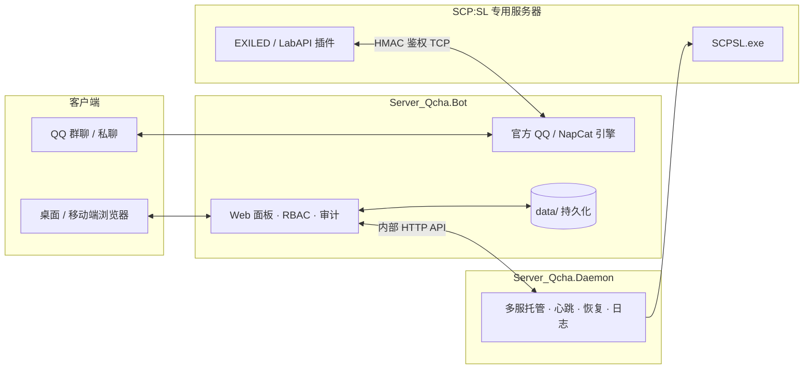

<div align="center">

<a href="https://github.com/jikekei/Server_Qchat">
  
</a>

<h1>Server_Qcha (Qridge)</h1>

<p>
  <strong>现代化的 SCP: Secret Laboratory 浏览器运维面板与 QQ 机器人桥接系统</strong>
</p>

<p>
  <a href="../../README.md">English</a> ·
  <strong>简体中文</strong> ·
  <a href="#核心特性">核心特性</a> ·
  <a href="#快速开始">快速开始</a> ·
  <a href="#系统架构">系统架构</a> ·
  <a href="../README.zh-CN.md">完整文档</a>
</p>

<p>
  <a href="https://github.com/jikekei/Server_Qchat/releases">
    
  </a>
  <a href="https://github.com/jikekei/Server_Qchat/actions/workflows/ci.yml">
    
  </a>
  <a href="https://dotnet.microsoft.com/">
    
  </a>
  <a href="https://github.com/jikekei/Server_Qchat/releases/latest">
    
  </a>
  <a href="https://bot.q.qq.com/">
    
  </a>
  <a href="../../LICENSE">
    
  </a>
</p>

</div>

---

**Server_Qcha（Qridge）** 将 SCP:SL 专用服务器从传统的本地命令行窗口升级为**全端浏览器运维工作台**。通过将游戏服进程托管与 Web 面板、QQ 机器人解耦，面板的日常更新与重启不会中断任何正在进行的对局。

## 为什么选择 Qridge

| 能力维度 | 原生 LocalAdmin | Qridge |
| :--- | :---: | :---: |
| **面板 / 机器人重启不掉服** | ❌ 关闭即断开 | ✅ 独立守护进程托管 |
| **桌面与移动端浏览器运维** | ❌ 需 RDP / SSH | ✅ 自适应全端 Web 控制台 |
| **SteamCMD 无感更新与回滚** | ❌ 手动停服更新 | ✅ 后台预下载 · 回合末切换 · 自动回滚 |
| **游戏内管理员与权限组热编辑** | ❌ 手改配置文件 | ✅ 面板可视化编辑 · 插件即时生效 |
| **多账号权限隔离与操作审计** | ❌ 无 | ✅ 细粒度 RBAC + 完整审计日志 |
| **QQ 群指令与游戏内求助告警** | ❌ 无 | ✅ 支持官方 QQ 机器人 / NapCat 双引擎 |

## 核心特性

- **独立守护进程** — 游戏服由 `Server_Qcha.Daemon` 独立托管，面板与机器人崩溃、更新或重启均不影响在线玩家；内置心跳监控、静默卡死检测与内存超限自动回合末重启。
- **一键无感更新** — 通过面板调用 SteamCMD 在后台暂存下载新版本，回合结束自动切换（空闲时立即生效），支持一键回滚及启动失败自动回退。
- **实时 Web 控制台** — 桌面与移动端自适应，支持彩色实时日志流、日志级别过滤、历史回看位置锁定，以及 24 小时在线趋势与资源占用监控。
- **可视化游戏权限管理** — 在线编辑各服务器管理员、权限组徽章与细粒度节点，支持跨服复制分组；撤销在线管理员通过插件立即生效，无需重启服务器。
- **双引擎 QQ 机器人** — 同时兼容腾讯官方 QQ 机器人（OpenAPI v2）与 NapCat（OneBot 11），支持运行期热切换，并支持游戏内 `.ac` 一键向 QQ 群发送求助告警。
- **团队协作与插件生态** — 提供多账号 RBAC 权限管理与操作审计；配套 **EXILED (`9.15.2`)** 与 **LabAPI (`1.1.7+`)** 双框架插件，可选接入 MySQL 实现玩家统计与封禁同步。

## 面板概览

<div align="center">
  
  <p><sub>Qridge 网页运维面板预览 · <a href="guides/web-panel.md">查看完整面板指南 →</a></sub></p>
</div>

## 快速开始

### 1. 下载与配置

前往 [Releases](https://github.com/jikekei/Server_Qchat/releases/latest) 下载对应平台（Windows / Linux）的自包含发布包并解压。复制示例配置文件并填写游戏服路径、QQ 机器人信息与强随机通信令牌（建议 ≥ 24 位）：

```bash
cp appsettings.Example.json appsettings.Local.json
```

> [!TIP]
> 升级现有版本前，请先备份 `data/` 目录与 `appsettings.json`。

### 2. 安装游戏插件

下载对应框架的 **EXILED** 或 **LabAPI** 插件压缩包，解压至游戏服务器的插件目录，并确保 `dependencies/` 文件夹与 `Server_Qcha.dll` 位于同级目录。

### 3. 启动服务

- **Windows**：运行 `一键启动(守护+机器人).bat`（或直接启动 `Server_Qcha.Bot.exe`）
- **Linux**：运行 `./Server_Qcha.Bot`（将自动拉起守护进程）

启动后打开浏览器访问 `http://127.0.0.1:8080/`，使用控制台输出的初始凭据登录即可。

> [!WARNING]
> **网络安全提示**
> - 面板默认仅监听本机回环地址（`127.0.0.1`），如需公网或局域网访问，请修改 `WebPanel:Host` 为 `0.0.0.0` 并配置防火墙。
> - 插件与机器人之间的 TCP 通道仅做 HMAC 签名鉴权而**不加密**，切勿直接暴露至公网，跨机部署请使用 VPN 或防火墙白名单。

## 系统架构



## 文档中心

| 分类 | 文档 |
| :--- | :--- |
| **入门与面板** | [中文文档索引](../README.zh-CN.md) · [English Docs](../README.md) · [Web 面板使用指南](guides/web-panel.md) |
| **机器人与配置** | [机器人配置指南](guides/bot-guide.md) · [完整配置参考](guides/configuration.md) · [插件与数据库](guides/plugin-guide.md#玩家统计与数据库封禁) |
| **安全与维护** | [数据库与构建安全说明](guides/database-security.md) · [自动化与发布指南](reference/automation.md) |

## 参与贡献

欢迎通过 [GitHub Issues](https://github.com/jikekei/Server_Qchat/issues) 提交 Bug 反馈或功能建议，也欢迎直接发起 Pull Request。

## 开源协议

本项目基于 [Apache License 2.0](../../LICENSE) 协议开源。SCP: Secret Laboratory、Unity、EXILED 与 LabAPI 均归各自版权方所有，本仓库不分发游戏服务器引用程序集。
