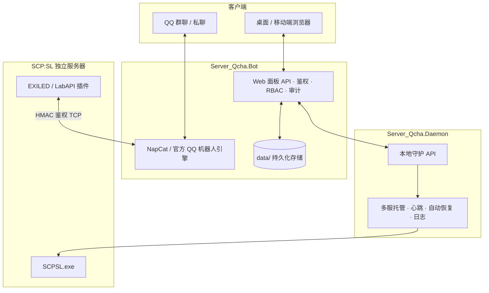

### 面向 SCP: Secret Laboratory 的现代 Web 运维面板与 QQ 机器人桥接

[English](../../README.md) · [简体中文](README.md) · [完整文档](../README.zh-CN.md) · [下载最新版](https://github.com/jikekei/Server_Qchat/releases/latest) · [反馈问题](https://github.com/jikekei/Server_Qchat/issues)

---

**Server_Qcha（Qridge）** 将传统的本地命令行开服升级为**浏览器一站式运维**：集成独立进程守护、Web 实时控制台、可视化权限管理、双引擎 QQ 机器人，以及 EXILED / LabAPI 配套插件。

## 核心能力

<table>
  <tr>
    <td width="50%" valign="top">
      <b>🛡️ 独立进程守护，重启不掉服</b> 
      游戏服由独立守护进程托管。更新、重启甚至异常退出面板或机器人，在线玩家均不受影响；支持异常卡死检测与内存超限自动回合末重启。
    </td>
    <td width="50%" valign="top">
      <b>🔄 SteamCMD 无感更新与回滚</b> 
      面板一键触发后台预下载，运行中零中断，回合结束自动切换新版本（空闲时立即生效）。保留旧版支持一键回滚，启动失败自动回退。
    </td>
  </tr>
  <tr>
    <td width="50%" valign="top">
      <b>💻 全端 Web 控制台与监控</b> 
      兼容桌面与移动端浏览器。支持彩色实时日志、级别过滤与历史回看锁定，内置 24 小时在线趋势、峰值统计与实时进程资源监控。
    </td>
    <td width="50%" valign="top">
      <b>👑 游戏内权限可视化热生效</b> 
      在线管理各服管理员与权限组（徽章、颜色、细粒度节点、跨服复制），告别手动编辑配置文件；撤销在线管理员即时生效，无需重启游戏服。
    </td>
  </tr>
  <tr>
    <td width="50%" valign="top">
      <b>💬 双引擎 QQ 社群联动</b> 
      同时支持腾讯官方 QQ 机器人与 NapCat（OneBot 11），可在线热切换。支持群内查服控服，玩家在游戏内发送 <code>.ac</code> 可实时推送求助至 QQ 群。
    </td>
    <td width="50%" valign="top">
      <b>🔐 多人协作审计与插件生态</b> 
      内置多账号权限隔离（RBAC）与完整操作审计日志。官方提供 EXILED 与 LabAPI 双框架插件，可选对接 MySQL 实现玩家数据统计与封禁同步。
    </td>
  </tr>
</table>

## 面板模块

  
  九大核心模块覆盖 <b>监控与运行</b>、<b>社群与权限</b>、<b>数据与追溯</b>（<a href="guides/web-panel.md">查看面板使用指南</a>）

## 相比原生 LocalAdmin

| 运维场景 | 原生 LocalAdmin | Qridge |
| :--- | :--- | :--- |
| **进程稳定性** | 关闭窗口即断开服务器 | 独立守护托管，面板与机器人重启**不掉服** |
| **版本更新** | 手动停服执行 SteamCMD | 后台预下载、回合末切换、**启动失败自动回滚** |
| **远程与多服** | 依赖 RDP/SSH，每服独立窗口 | 桌面/手机浏览器统一管理全部实例 |
| **权限管理** | 手动修改 `config_remoteadmin.txt` | 面板可视化编辑，**插件实时热生效** |
| **协作与社群** | 无账号隔离、无群通知 | 多账号 RBAC 审计 + QQ 机器人指令与 `.ac` 告警 |

## 快速开始

1. **下载与配置**：前往 [Releases](https://github.com/jikekei/Server_Qchat/releases/latest) 下载 Windows / Linux 自包含包并解压；复制 `appsettings.Example.json` 为 `appsettings.Local.json`，填写游戏服路径、QQ 机器人配置与强随机令牌。
2. **安装插件**：下载对应的 EXILED（`9.15.2`）或 LabAPI（`1.1.7+`）插件包，解压至游戏服插件目录（保持 `dependencies/` 与 `Server_Qcha.dll` 同级）。
3. **启动并登录**：Windows 运行 `一键启动(守护+机器人).bat`（Linux 运行 `./Server_Qcha.Bot`），浏览器访问 `http://127.0.0.1:8080/`，使用控制台输出的初始凭据登录。

<b>📐 查看系统架构图</b>

 

<b>🔒 安全与部署注意事项</b>

 

- **公网访问**：面板默认仅监听本机回环地址（`127.0.0.1`）。如需跨设备访问，请将 `WebPanel:Host` 设为 `0.0.0.0` 并配置防火墙规则。
- **通信安全**：插件与机器人之间的 TCP 通道仅做 **HMAC 签名鉴权而不加密**，切勿直接暴露至公网，跨机部署请使用 VPN 或防火墙 IP 白名单。
- **凭据与白名单**：建议为机器人、守护进程与插件配置一致的 **≥ 24 位随机令牌**；如需严格控制 QQ 端操作权限，请显式配置管理员与群白名单。

## 文档导航

| 分类 | 文档链接 |
| :--- | :--- |
| **入门与面板** | [中文文档索引](../README.zh-CN.md) · [English Docs](../README.md) · [Web 面板指南](guides/web-panel.md) |
| **机器人与配置** | [机器人指南](guides/bot-guide.md) · [配置参考](guides/configuration.md) · [插件与数据库](guides/plugin-guide.md#玩家统计与数据库封禁) |
| **安全与维护** | [数据库与构建安全](guides/database-security.md) · [自动化发布指南](reference/automation.md) |

---

  基于 <a href="../../LICENSE">Apache License 2.0</a> 开源 · 本仓库不分发游戏服务器引用程序集

