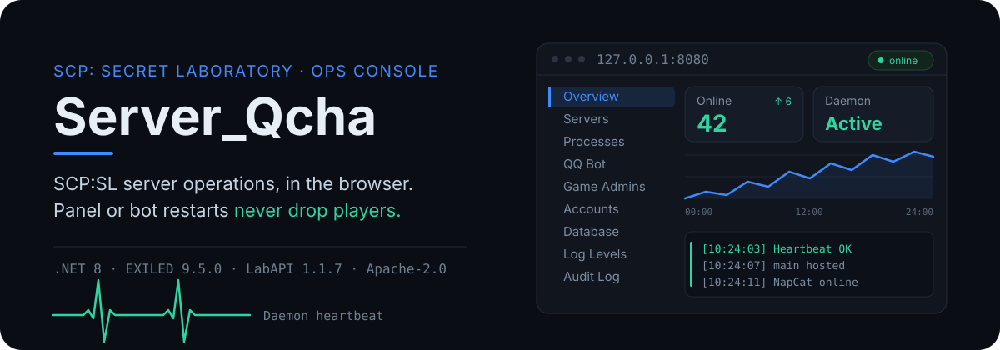
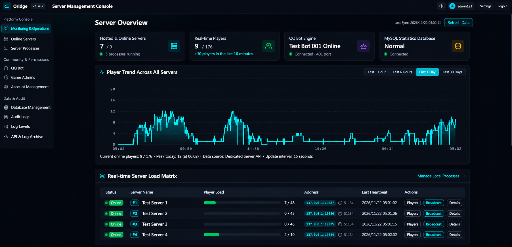
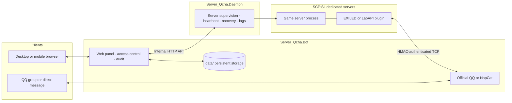

<div align="center">

<a href="https://github.com/jikekei/Server_Qchat">
  
</a>

<h1>Server_Qcha (Qridge)</h1>

<p><strong>A browser-based operations panel and QQ bot bridge for SCP: Secret Laboratory</strong></p>

<p><strong>English</strong> · <a href="docs/zh-CN/README.md">简体中文</a> · <a href="#key-features">Key features</a> · <a href="#quick-start">Quick start</a> · <a href="#architecture">Architecture</a> · <a href="docs/README.md">Documentation</a></p>

[](https://github.com/jikekei/Server_Qchat/releases)
[](https://github.com/jikekei/Server_Qchat/actions/workflows/ci.yml)
[](https://dotnet.microsoft.com/)
[](https://github.com/jikekei/Server_Qchat/releases)
[](https://bot.q.qq.com/)
[](LICENSE)

</div>

---

**Server_Qcha (Qridge)** brings the SCP:SL console, server management, and QQ integration into one browser panel. With the standalone daemon supervising the game servers, you can update or restart the panel and bot while the game servers keep running.

## Why Qridge?

| Capability | Official LocalAdmin | Qridge |
| --- | --- | --- |
| Panel or bot restarts | Local console runs with the LocalAdmin process | Game servers run under a standalone daemon |
| Desktop and mobile access | Local command line | Responsive web console |
| SteamCMD updates and rollback | Manual updates | Background staging, round-end deployment, and automatic rollback on startup failure |
| In-game admins and permission groups | Edit configuration files | Edit in the panel and apply live through the plugin |
| Team access | Managed through host access | Role-based access for multiple accounts and an audit log |
| QQ integration | Requires an external integration | Official QQ Bot or NapCat, with in-game help alerts |

## Key features

- **Standalone daemon.** `Server_Qcha.Daemon` supervises multiple game servers and monitors heartbeats, hangs, and memory usage. When players are connected, memory recovery can be scheduled for the end of the round.
- **SteamCMD updates while servers are running.** Stage new builds in the background, update servers in batches, schedule update checks, or book an update for later. Apply the update at round end or immediately on idle servers. Roll back manually or let Qridge restore the previous build if the new one fails to start.
- **Live web console.** View color-coded logs on desktop or mobile and filter by level. Scrolling back keeps your place, and the follow control jumps to the latest output. The dashboard shows 24-hour player trends and resource usage.
- **In-game admins and permission groups.** Edit administrators, group badges, and individual permissions in the panel, and copy groups between servers. Plugins apply changes live, including revoking an online administrator's access.
- **Two QQ bot engines.** Use Tencent's official QQ Bot (OpenAPI v2) or NapCat (OneBot 11), and switch while the bot is running. Players can send `.ac <message>` in-game to ask for help in a configured QQ group.
- **Team access and game plugins.** Manage roles across multiple accounts and review operator actions. The plugins are built against EXILED `9.15.2` and LabAPI `1.1.7` respectively. Optional MySQL integration records player statistics and synchronizes bans.

## The panel at a glance

<div align="center">
  
  <p><sub><a href="docs/en/guides/web-panel.md">Read the web panel guide</a></sub></p>
</div>

## Quick start

### 1. Download and configure

Download the self-contained package for Windows or Linux and extract it. Copy the sample settings file, then configure the game-server paths, QQ bot credentials, and authentication tokens. Use random tokens of at least 24 characters, and match the bot and plugin communication tokens. [Releases](https://github.com/jikekei/Server_Qchat/releases) · [Configuration reference](docs/en/guides/configuration.md)

**Windows PowerShell**

```powershell
Copy-Item appsettings.Example.json appsettings.Local.json
```

**Linux**

```bash
cp appsettings.Example.json appsettings.Local.json
```

> [!TIP]
> Before upgrading, back up `data/` and your existing `appsettings*.json` configuration files.

### 2. Install a game plugin

Download the EXILED or LabAPI package for your server's framework. Follow the plugin guide to install `Server_Qcha.dll` and the included `dependencies/` directory, then set the token to match the bot. [Plugin guide](docs/en/guides/plugin-guide.md)

### 3. Start the services

- **Windows** Run `一键启动(守护+机器人).bat` or launch `Server_Qcha.Bot.exe` directly.
- **Linux** Run `./Server_Qcha.Bot`. If daemon auto-start is enabled, the bot starts it when needed.

Open `http://127.0.0.1:8080/` and sign in with the initial credentials printed on first startup. [Deployment guide](docs/en/guides/getting-started.md)

> [!WARNING]
> The panel listens on `127.0.0.1` by default. For access from other devices, set `WebPanel:Host` and restrict access with a firewall. Plugin TCP traffic is authenticated with HMAC and travels unencrypted. Use a private network or VPN for cross-host deployments.

## Architecture



## Documentation

| Topic | Guides |
| --- | --- |
| Getting started and the panel | [English documentation](docs/README.md) · [中文文档索引](docs/README.zh-CN.md) · [Web panel guide](docs/en/guides/web-panel.md) |
| Bot and configuration | [QQ bot guide](docs/en/guides/bot-guide.md) · [Configuration reference](docs/en/guides/configuration.md) · [Plugins and MySQL](docs/zh-CN/guides/plugin-guide.md#玩家统计与数据库封禁) (Chinese) |
| Security and maintenance | [Database and build security](docs/en/guides/database-security.md) · [CI and release automation](docs/zh-CN/reference/automation.md) (Chinese) |

## Contributing

Report bugs, suggest features, or send a patch. [GitHub Issues](https://github.com/jikekei/Server_Qchat/issues) · [Pull Requests](https://github.com/jikekei/Server_Qchat/pulls)

## License

Qridge is released under the Apache License 2.0. SCP: Secret Laboratory, Unity, EXILED, and LabAPI are subject to their respective terms. [Apache License 2.0](LICENSE)
