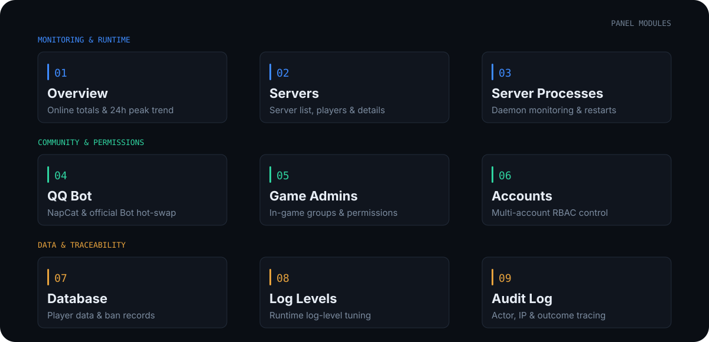
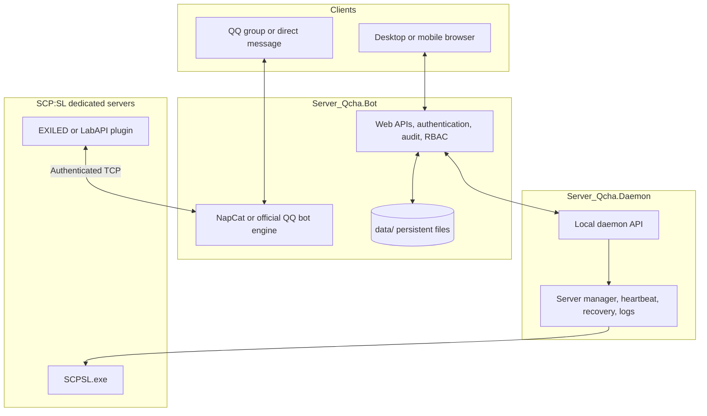

[English](README.md) · [简体中文](docs/zh-CN/README.md)

[English Docs](docs/README.md) · [中文文档](docs/README.zh-CN.md) · [Latest Release](https://github.com/jikekei/Server_Qchat/releases/latest) · [Report an Issue](https://github.com/jikekei/Server_Qchat/issues)

---

**Server_Qcha** (also known as **Qridge**) is a browser-based operations panel and QQ bot bridge for **SCP: Secret Laboratory** dedicated servers. By decoupling process supervision from the web panel and bot, **restarting, updating, or crashing the panel never drops active game servers or players**.

It combines a standalone daemon supervisor, a dual-engine QQ bot, a mobile-ready web console, and official plugins for both EXILED and LabAPI.

## Key Features

### Server Lifecycle & Operations
- **Decoupled LocalAdmin Supervisor (`Server_Qcha.Daemon`)**: Isolates game-server lifecycles from the panel and bot. The bot can auto-start the daemon, while daemon health—PID, working-set/private memory, uptime, thread count, and managed-server load—can be monitored and controlled live from the panel.
- **Zero-Interruption SteamCMD Updates**: Updates managed SCP:SL dedicated servers (App `996560`, optional beta branch) from the panel into a staging copy while the server stays online. Swaps in automatically at round end (`restartnextround`), immediately when idle, or on demand (*update now* / *cancel*). Retains the previous build for one-click rollback and auto-rolls back if a new build fails to start (via `LocalAdmin:SteamCmdPath`).
- **Per-Server Memory Recovery**: Automatically triggers a round-end restart (`rnr`) when sustained physical memory exceeds the configured limit (default `2 GiB`), or restarts immediately if idle. Set to `0` per instance to disable.

### Web Panel & Access Governance
- **Qridge Web Console**: Built with Vue 3 and Element Plus via native ES modules (no front-end build step). Streams live logs with ANSI color decoding, circular log buffering, log-level filtering, scroll-position preservation while reading history, and jump-to-latest following.
- **Operations Dashboard & Mobile Layout**: Tracks 24-hour online-player trends, daily peaks, and sampled stats (filtering out the Dedicated Server placeholder). Automatically switches to a touch-friendly drawer layout below `768 px`.
- **Live In-Game Admin & Group Management**: Edits each server's `config_remoteadmin.txt` directly in the panel—granularity down to individual permissions, badge text/color, plugin permission nodes (master switch + allow/deny rules), and per-user overrides. Supports cross-server group cloning and applies changes live via the plugin (e.g., revoking an online admin takes effect immediately without restarting). Requires the `game-admin.manage` panel permission.
- **Multi-Account RBAC & Audit Trail**: Supports concurrent operator sessions, PBKDF2-SHA256 password hashing, granular panel permissions, and full audit logs recording actor, timestamp, source IP, and outcome.

### QQ Bot & Game Plugins
- **Dual QQ Bot Engines**: Supports **NapCat (OneBot 11)** and **Tencent Official QQ Bot OpenAPI v2**, with runtime engine switching and official command-panel sync (`/v2/panels`).
- **EXILED & LabAPI Plugins**: Built for `ExMod.Exiled` `9.15.2` (other versions unverified) and `LabAPI` `1.1.7+`. Includes in-game `.ac <message>` help alerts routed to QQ groups and optional MySQL integration for player statistics and account-ID ban enforcement ([configuration (ZH)](docs/zh-CN/guides/plugin-guide.md#玩家统计与数据库封禁)).

## The Panel at a Glance

*Nine core modules grouped into **Monitoring & Runtime**, **Community & Permissions**, and **Data & Traceability**. See the [web panel guide](docs/en/guides/web-panel.md) for details.*

## Qridge vs. Official LocalAdmin

| Capability | Official LocalAdmin | Qridge |
| --- | --- | --- |
| **Interface** | Local CLI window | Desktop & mobile web console |
| **Process Lifecycle** | Closing the window terminates the server | Independent daemon keeps game servers online across panel/bot restarts |
| **Multi-Server Management** | One window per instance | Unified panel for the daemon and all managed servers |
| **Remote Operations** | Requires RDP or SSH | Browser access from authorized devices |
| **Server Updates** | Manual SteamCMD update & downtime | Staged SteamCMD download, round-end swap, and auto-rollback |
| **Recovery & Watchdog** | Basic restart behavior | Heartbeats, silent-hang detection, memory recovery, and restart-rate limits |
| **Monitoring** | None | Live memory, PID, uptime, and 24-hour player trends |
| **Console** | Basic terminal output | Buffered web console with ANSI colors and live log-level filtering |
| **Panel Access Control** | Full host access = full control | Multi-account RBAC with audit logging |
| **In-Game Permissions** | Manual edits to `config_remoteadmin.txt` | Visual panel editor with live plugin hot-apply |
| **Community Integration** | None | NapCat / Official QQ Bot commands and in-game `.ac` help alerts |

## Architecture

`Server_Qcha.Daemon` supervises the game processes and retains their console pipes. `Server_Qcha.Bot` communicates with the daemon over an internal HTTP API, while game plugins connect to the bot through dedicated command and notification TCP channels.

## Quick Start

1. **Download**: Grab the self-contained Windows or Linux package from the [latest release](https://github.com/jikekei/Server_Qchat/releases/latest) and extract it to a deployment directory.
2. **Configure**: If upgrading, back up `data/` and `appsettings.json` first. Copy `appsettings.Example.json` to `appsettings.Local.json` and configure your QQ connection and game-server paths.
3. **Secure**: Set strong random tokens (≥ 24 characters) for bot–plugin and daemon authentication, and configure explicit QQ admin and group allowlists where required.
4. **Install Plugin**: Extract the matching EXILED or LabAPI plugin ZIP into your game server's plugin folder, keeping the `dependencies/` directory alongside `Server_Qcha.dll` ([downloads](https://github.com/jikekei/Server_Qchat/releases/latest)).
5. **Launch**:
   - **Windows**: Run `一键启动(守护+机器人).bat` or start `Server_Qcha.Bot.exe`.
   - **Linux**: Run `./Server_Qcha.Bot` (which can start the daemon automatically).
6. **Sign In**: Open `http://127.0.0.1:8080/` and log in using the initial credentials printed to the console.

> [!NOTE]
> The panel binds to loopback (`127.0.0.1`) by default. To access it from other devices, set `WebPanel:Host` to `0.0.0.0` and restrict access with a firewall. Startup logs automatically print detected local IPv4 panel URLs.

## Documentation

| Topic | English | 简体中文 |
| --- | --- | --- |
| **Documentation Index** | [docs/README.md](docs/README.md) | [docs/README.zh-CN.md](docs/README.zh-CN.md) |
| **Getting Started** | [Getting Started Guide](docs/en/guides/getting-started.md) | — |
| **Web Panel** | [Web Panel Guide](docs/en/guides/web-panel.md) | [面板使用指南](docs/zh-CN/guides/web-panel.md) |
| **Bot & Configuration** | [Bot Component Guide](docs/en/components/bot.md) | [机器人指南](docs/zh-CN/guides/bot-guide.md) · [配置参考](docs/zh-CN/guides/configuration.md) |
| **Game Plugins** | [EXILED Plugin](docs/en/components/exiled-plugin.md) · [LabAPI Plugin](docs/en/components/labapi-plugin.md) | [插件与数据库指南](docs/zh-CN/guides/plugin-guide.md#玩家统计与数据库封禁) |
| **Security & Maintainers** | — | [数据库与构建安全说明](docs/zh-CN/guides/database-security.md) · [自动化发布指南](docs/zh-CN/reference/automation.md) |

## Security & Compatibility

> [!WARNING]
> **Do not expose the plugin TCP listeners to untrusted networks.** Protocol messages are authenticated with HMAC using a shared token, **not encrypted**. Use a VPN or firewall allowlist for cross-machine deployments.

- **Shared Tokens**: Configure matching random tokens of at least **24 characters** across the bot, daemon, and game plugin. Empty tokens or legacy public defaults trigger a warning on startup for backward compatibility only.
- **QQ Access Control**: Leaving QQ administrator allowlists empty retains legacy role-based behavior. Configure explicit administrator and group allowlists whenever strict access control is required.

## License

Licensed under the [Apache License 2.0](LICENSE).

SCP: Secret Laboratory, Unity, EXILED, and LabAPI remain subject to their respective owners' terms. Game-server reference assemblies are not distributed in this repository—see the [database and build-reference security notes (ZH)](docs/zh-CN/guides/database-security.md) for details.
