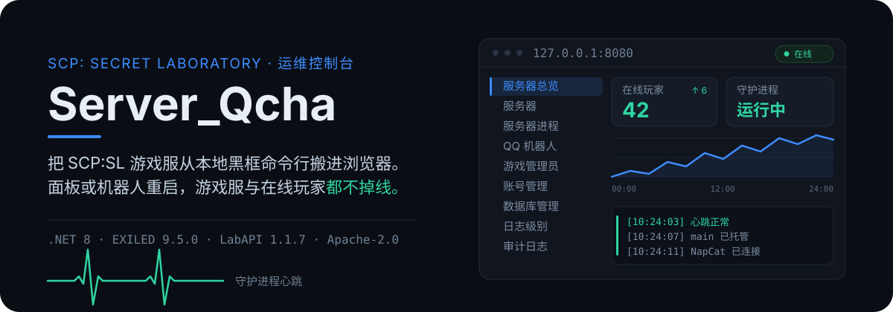
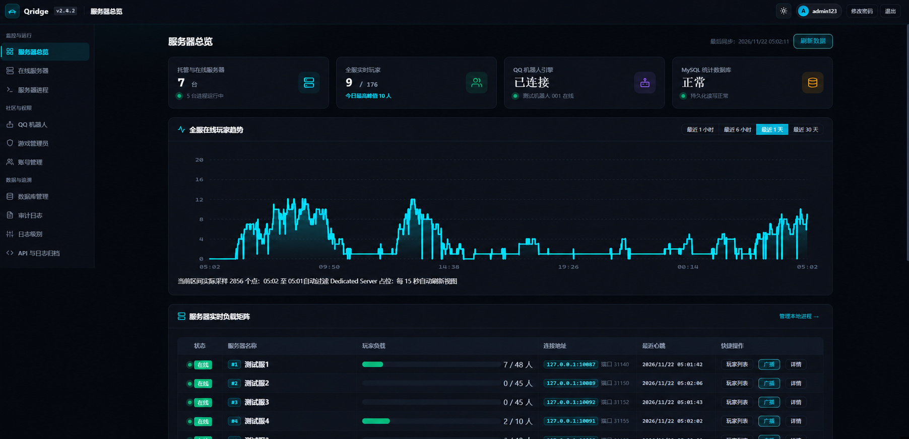
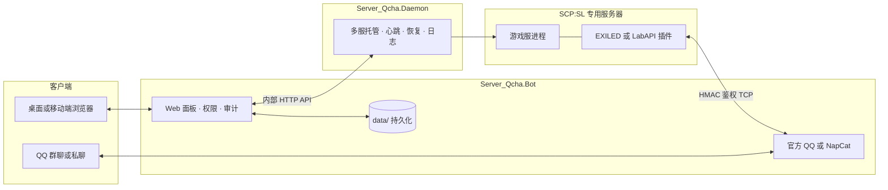

<div align="center">

<a href="https://github.com/jikekei/Server_Qchat">
  
</a>

<h1>Server_Qcha (Qridge)</h1>

<p><strong>现代化的 SCP: Secret Laboratory 浏览器运维面板与 QQ 机器人桥接系统</strong></p>

<p><a href="../../README.md">English</a> · <strong>简体中文</strong> · <a href="#核心特性">核心特性</a> · <a href="#快速开始">快速开始</a> · <a href="#系统架构">系统架构</a> · <a href="../README.zh-CN.md">完整文档</a></p>

[](https://github.com/jikekei/Server_Qchat/releases)
[](https://github.com/jikekei/Server_Qchat/actions/workflows/ci.yml)
[](https://dotnet.microsoft.com/)
[](https://github.com/jikekei/Server_Qchat/releases)
[](https://bot.q.qq.com/)
[](../../LICENSE)

</div>

---

**Server_Qcha（Qridge）** 将 SCP:SL 专用服务器的控制台、进程管理和 QQ 群联动集中到浏览器。由独立守护进程托管时，更新或重启面板和机器人，游戏服仍可继续运行。

## 为什么选择 Qridge

| 能力 | 原生 LocalAdmin | Qridge |
| --- | --- | --- |
| 面板或机器人重启 | 本地控制台随 LocalAdmin 进程运行 | 游戏服由独立守护进程托管 |
| 桌面与移动端运维 | 本地命令行 | 自适应 Web 控制台 |
| SteamCMD 更新与回滚 | 手动更新 | 后台暂存、回合结束切换、启动失败自动回滚 |
| 游戏管理员与权限组 | 编辑配置文件 | 面板编辑，插件在线应用 |
| 团队协作 | 通过主机管理访问权限 | 多账号角色权限和操作审计 |
| QQ 群联动 | 通过外部集成实现 | 官方 QQ 机器人或 NapCat，支持游戏内求助 |

## 核心特性

- **独立守护进程**。`Server_Qcha.Daemon` 独立托管多台游戏服，提供心跳监控、卡死检测和内存超限恢复。有玩家在线时，内存恢复可安排到回合结束。
- **SteamCMD 在线更新**。游戏服运行期间可下载并暂存新版本，支持批量更新、定时检查和预约更新。新版本可在回合结束时切换，空闲服可立即切换。支持手动回滚，启动失败时自动回退。
- **实时 Web 控制台**。桌面和移动端可查看彩色日志、按级别过滤，以及回看历史日志。向上滚动时保留当前位置，点击「跟随日志」回到最新输出。总览显示 24 小时在线趋势和资源占用。
- **游戏管理员与权限组**。在面板里编辑各服管理员、权限组徽章和权限节点，支持跨服复制分组。插件在线应用修改，撤销在线管理员权限无需重启。
- **双引擎 QQ 机器人**。支持腾讯官方 QQ 机器人（OpenAPI v2）与 NapCat（OneBot 11），可在线切换。玩家可用 `.ac <内容>` 向指定 QQ 群发送求助。
- **团队协作与插件**。提供多账号角色权限管理与操作审计。EXILED 插件以 `9.15.2` 为构建依赖，LabAPI 插件以 `1.1.7` 为构建依赖。可选用 MySQL 记录玩家统计、同步封禁。

## 面板概览

<div align="center">
  
  <p><sub><a href="guides/web-panel.md">查看 Web 面板指南</a></sub></p>
</div>

## 快速开始

### 1. 下载与配置

下载对应系统的 Windows 或 Linux 自包含包并解压。复制示例配置，填写游戏服路径、QQ 机器人信息和通信令牌。使用至少 24 字符的随机令牌，并让插件和 Bot 的通信令牌一致。 [发布包下载](https://github.com/jikekei/Server_Qchat/releases) · [配置参考](guides/configuration.md)

**Windows PowerShell**

```powershell
Copy-Item appsettings.Example.json appsettings.Local.json
```

**Linux**

```bash
cp appsettings.Example.json appsettings.Local.json
```

> [!TIP]
> 升级前备份 `data/` 和现有的 `appsettings*.json` 配置文件。

### 2. 安装游戏插件

按游戏服使用的框架下载 EXILED 或 LabAPI 插件包。按插件指南部署 `Server_Qcha.dll` 和随包提供的 `dependencies/`，并配置与 Bot 一致的通信令牌。 [插件指南](guides/plugin-guide.md)

### 3. 启动服务

- **Windows** 可运行 `一键启动(守护+机器人).bat`，或直接启动 `Server_Qcha.Bot.exe`。
- **Linux** 可运行 `./Server_Qcha.Bot`。启用守护进程自动启动后，Bot 会在需要时启动它。

打开 `http://127.0.0.1:8080/`，使用首次启动时打印的初始凭据登录。 [部署指南](guides/getting-started.md)

> [!WARNING]
> 面板默认监听 `127.0.0.1`。如需从其他设备访问，可调整 `WebPanel:Host` 并通过防火墙限制来源。插件与 Bot 的 TCP 通信使用 HMAC 鉴权，传输内容未加密，跨机部署请使用私有网络或 VPN。

## 系统架构



## 文档中心

| 分类 | 文档 |
| --- | --- |
| 入门与面板 | [中文文档索引](../README.zh-CN.md) · [English Docs](../README.md) · [Web 面板指南](guides/web-panel.md) |
| 机器人与配置 | [机器人配置指南](guides/bot-guide.md) · [完整配置参考](guides/configuration.md) · [插件与数据库](guides/plugin-guide.md#玩家统计与数据库封禁) |
| 安全与维护 | [数据库与构建安全说明](guides/database-security.md) · [自动化与发布指南](reference/automation.md) |

## 参与贡献

欢迎反馈问题、提出功能建议或提交改进。 [GitHub Issues](https://github.com/jikekei/Server_Qchat/issues) · [Pull Requests](https://github.com/jikekei/Server_Qchat/pulls)

## 开源协议

本项目按 Apache License 2.0 开源。SCP: Secret Laboratory、Unity、EXILED 和 LabAPI 适用各自的许可条款。 [Apache License 2.0](../../LICENSE)
